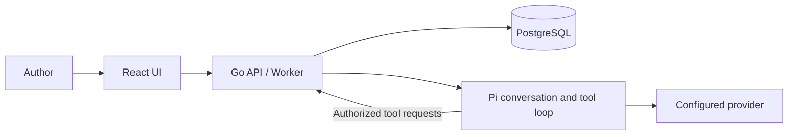

# Yantai · 砚台

**A writing workspace for turning an idea into a novel with a voice of its own.**

[简体中文](README.md) · [Quick start](#quick-start) · [Writing Skills](#writing-skills) · [Deployment](deploy/README.md) · [Changelog](CHANGELOG.md)

Yantai is a self-hosted workspace for long-form Chinese fiction. Start with a book plan, develop characters and world rules, then write and revise with an AI partner that can read the book's permitted sources. Generated passages and plans remain candidates until the author chooses to adopt them.

In the current source, each book opens with saved progress, items needing attention, and one action to resume writing. Planning, materials, and AI discussion open when needed; less frequent actions live under **更多** (More). See the [author workflow](docs/development/author-workflow.md) for data sources and limits.

The interface is primarily in Chinese. Version **0.4.0** supports the web, an installable PWA, and a Windows portable desktop build. It uses Go, React/TypeScript, PostgreSQL, and Pi.


## What it does

| Area | Features |
| --- | --- |
| Planning | Book library, new-book wizard, planning before any chapters exist, character/world settings, outlines, scenes, character arcs, story canvas |
| Manuscripts | Rich-text editing, autosave and recovery buffers, immutable revisions, conflict protection, selection-based rewriting, candidate diffs and explicit adoption |
| AI partner | Pi tool loop, streaming, persistent conversations, reconnect, cancellation, context compaction, book and chapter scopes |
| Writing Skills | Preview and import Markdown/ZIP/GitHub/JSON guides, per-book task scopes and priority, versioned edits, complete-package updates, portable exports |
| Author memory (current source) | Private cross-book preferences, voice, collaboration habits and conversation notes; confirmed suggestions, per-turn disclosure, edit/forget and portable import/export |
| Story memory | Evidence-backed location, injury, ownership, character knowledge/belief, and foreshadowing; revision impact and filtered retrieval |
| Advanced tools | Versioned prompts and agents, persistent DAG workflows, review gates, chapter batches, candidate comparison, rule-based sandbox and branches |
| Collaboration and export | Member roles, invitations, comments, presence, project packages, Markdown/TXT/DOCX/EPUB/PDF/HTML |
| Integrations | Multiple model providers, optional embeddings/reranking, read-only MCP, source research, and separately configured cover/TTS providers |

Go checks permissions, versions, story evidence, budgets, and adoption. Pi handles the conversation and tool loop. Summaries and suggested plans do not become confirmed story facts automatically.

Literary quality, time saved, and long-term voice consistency require evaluation with actual authors and manuscripts. Passing engineering tests is not a claim about those outcomes.


[](https://github.com/ToStarLiu/yantai-novel/actions/workflows/ci.yml)

Open author memory from **更多 → 作者记忆** in the top bar. Save a preference directly, remember one of your messages after review, or confirm a pending suggestion. Book and chapter Copilot, single writing tasks, and batch/candidate generation load relevant active notes; factual reviews and extraction remain independent of personal taste. Each task shows its private snapshot and supports opting out. The book’s Voice and Writing page brings together book requirements, personal preferences, original samples and Skills. Explicit candidate references support another revision, selected-passage edits, and comparison with the previous draft before adoption. This is a source-workspace addition, separate from the existing v0.4.0 release downloads. See the [product and privacy contract](docs/development/author-memory.md).

## Quick start

### Windows

Requirements: Windows x64, PowerShell 7 (`pwsh`), Git, and network access for the initial tool and dependency downloads.

Clone this repository and run from its root. Keep an existing `.env` rather than overwriting it:

```powershell
if (-not (Test-Path -LiteralPath .env)) { Copy-Item .env.example .env }
notepad .env
```

Set `AUTHOR_PASSWORD` to at least 12 characters. The default username is `author`. Model settings may remain blank until you configure a provider in the application.

```powershell
pwsh -File scripts/setup-dev.ps1
pwsh -File scripts/start.ps1
```

Open [http://127.0.0.1:8088](http://127.0.0.1:8088) and sign in with your configured credentials.

- Setup installs pinned Go, Node.js, sqlc, and PostgreSQL tools into `.tools/`. It does not modify the permanent PATH or install a database service.
- The start script starts the local database, builds the UI and Pi harness, applies explicit migrations, and runs the application. Use `-SkipBuild` for later starts when the existing builds are current.
- With `APP_PROVIDER=auto`, an entirely empty environment model connection starts the clearly labeled demo provider. It is for exploring the workflow. Saving and enabling a real default provider in the UI takes effect without restarting.
- Development PostgreSQL listens on loopback and stores data under `.local/pgdata`. This local development configuration is not intended for public network exposure.

Optionally add the repository's original three-chapter example from a second PowerShell window; this does not call a model:

```powershell
. ./scripts/dev.ps1 -Action env
go run ./cmd/seed
```

Pinned tool versions and download verification are documented in the [toolchain guide](docs/development/toolchain.md).

### Docker Compose

Compose definitions are provided for PostgreSQL, migrations, the API, and a separate worker. **This deployment path has not been executed in the project's local acceptance environment** and needs independent verification.

Copy `.env.example` to `.env` and configure:

- `AUTHOR_PASSWORD`: at least 12 characters.
- `POSTGRES_PASSWORD`: use a strong URL-safe value, such as at least 32 random hexadecimal characters. The current Compose file inserts it into a database URL.
- `PUBLIC_ORIGIN=http://127.0.0.1:8088`: use exactly this origin in the browser.

```sh
docker compose --env-file .env -f deploy/compose.yaml up --build -d
docker compose --env-file .env -f deploy/compose.yaml ps
```

Open [http://127.0.0.1:8088](http://127.0.0.1:8088). Portable development PostgreSQL and Compose both default to local port 55432, so use one at a time. See [deployment](deploy/README.md) for HTTPS, reverse proxies, and persistent volumes.

## Configure an AI provider

Open **更多 → AI 供应商** in the top bar. Enter the endpoint, protocol, model, and credentials; discover models and select the default connection. The provider page supports Chat Completions and Responses-compatible services. Advanced configuration also supports native Ollama, task routing, and retrieval services.

Environment configuration is supported as well:

```dotenv
LLM_BASE_URL=
LLM_API_KEY=
LLM_MODEL=
LLM_WIRE_API=responses
```

Provide a complete connection matching your service. Keep real keys out of commits, screenshots, and issues. Per-model prices must be configured separately: monetary amounts are estimates, unknown prices stay unknown, and a monetary budget blocks unpriced calls.

Embedding, reranking, search, cover generation, and TTS require their own configured services. Missing integrations are not replaced with pretend successful outputs. See [provider settings](docs/development/provider-settings.md) and [.env.example](.env.example).

## Writing Skills

Open **设定与规划 → 文风与写法** from a book, or choose **更多 → 写作 Skills** in the top bar.

1. Choose a starter template, paste Markdown, upload `SKILL.md`/ZIP/JSON, or provide a GitHub Skill link.
2. Preview the instructions, reference files, source, license, and compatibility warnings before saving.
3. Choose task scopes, priority, and enabled state for this book.
4. Save edits as a new version, update a complete package under the same identity, or export a guide for another book.

Five original Chinese starter templates cover concrete narration, dialogue and subtext, limited viewpoint, scene development, and the author's own voice samples. The catalog also offers six open-source recommendations pinned to specific commits, including Story Deslop, Writing Principles, and Scene Craft. Their licenses and dependencies can be reviewed before import.

Pi reads full instructions and references in bounded pages when needed. Each turn freezes its guide versions; changing the guides prevents outdated candidates from being adopted against the new baseline. Imported scripts, CLI commands, and other agents are not executed. Single-shot tasks load complete main instructions up to a 6,000-character limit; longer guides produce an explicit error with guidance to simplify them or use the conversational workflow.

Start with one to three complementary guides and adjust them using your own writing samples. A longer checklist does not guarantee better prose.


[Skill behavior and architecture](docs/development/writing-skills.md) · [Open-source guide research](docs/release/writing-skills-research.md)

## Architecture



Context separates author instructions, current authoritative sources, on-demand tool data, recent conversation, and derived summaries. Outdated source versions leave the active context. Claims about story facts must still resolve to valid source evidence. See [context engineering](docs/development/copilot-context.md).

```text
cmd/api/             HTTP, SSE, and web entry
cmd/worker/          Separate background execution
internal/workbench/  Books, revisions, memory, retrieval, jobs, and writing tools
internal/server/     Sessions, CSRF, membership, and API
harness/             Pi loop, streaming, and context compaction
migrations/          Explicit PostgreSQL migrations
web/                 React/TypeScript UI
desktop/             Windows Electron portable packaging
```

## Data, privacy, and backups

Books and execution records live in your PostgreSQL instance. External model calls send the required manuscript, settings, permitted memory, and selected guides to the provider you configure. Optional retrieval and media integrations send relevant data to their respective services.

Provider credentials entered in the UI are encrypted with AES-GCM on the backend and are not returned by read APIs. Preserve the independent master key with database backups. Environment credentials remain in your local `.env`. Responses calls set `store:false`; provider retention policies remain the provider's responsibility.

```powershell
pwsh -File scripts/backup.ps1
```

Restore uses a new isolated database and quarantines queues that might otherwise trigger external calls. A single-book JSON package preserves manuscripts, settings, current Skills, and story materials; it is not a full database backup and does not contain login credentials or provider secrets.

[Backup and restore](deploy/backup-restore.md) · [Project package coverage](docs/release/project-archive.md) · [Upgrades](deploy/upgrade.md)

## Windows desktop build

Download the Windows x64 package and checksums from [GitHub Releases](https://github.com/ToStarLiu/yantai-novel/releases).

The portable wrapper can include PostgreSQL, the API, web assets, Node/Pi, and Chinese fonts. First launch creates a separate data directory and a random local account, then signs in automatically. Application updates preserve that data. Developer environment files and book databases are excluded from the package.

After Windows tool setup, build from source:

```powershell
. ./scripts/dev.ps1 -Action env
go build -o .tools/api-advanced-next.exe ./cmd/api
npm --prefix web ci
npm --prefix web run build
npm --prefix harness ci
npm --prefix harness run build
npm --prefix harness run bundle
npm --prefix desktop ci
npm --prefix desktop run package
```

The executable is `desktop/dist/Yantai-win32-x64/Yantai.exe`; distribute the whole directory. Build outputs are not committed. The browser PWA caches only the static interface: saving and generation still require a connection to the application service.

## Development and verification

Dependency versions are pinned in `go.mod`/`go.sum` and the respective `package-lock.json` files. After preparing the Windows tools and starting PostgreSQL:

```powershell
. ./scripts/dev.ps1 -Action env
go test ./... -count=1
go vet ./...
npm --prefix web ci
npm --prefix web run typecheck
npm --prefix web run test -- --run
npm --prefix web run build
npm --prefix harness ci
npm --prefix harness run build
npm --prefix harness test
```

Database integration tests need `TEST_DATABASE_URL` and use isolated random schemas. Without that variable they explicitly skip; skipped tests do not establish database correctness. Browser tests require a separate demo service and test account. See [Playwright configuration](web/playwright.config.ts) and [frontend verification](docs/release/frontend-verification.md).

Recorded 0.4.0 verification includes 205 backend tests, 19 Pi tests against both source and standalone bundle, five frontend unit tests, and eight affected browser cases for this iteration. Desktop import/tool use/restart and a nonempty database restore were also verified. Details and limitations are in the [acceptance record](docs/release/acceptance.md). Container deployment and literary quality are separate, outstanding evaluations.

Read [CONTRIBUTING.md](CONTRIBUTING.md) before contributing. Follow [SECURITY.md](SECURITY.md) for vulnerabilities; do not put secrets or private manuscripts in public issues.

## Documentation and direction

Most detailed documentation is currently in Chinese:

- [Deployment](deploy/README.md), [upgrade](deploy/upgrade.md), and [recovery](deploy/recovery-drill.md).
- [Provider configuration](docs/development/provider-settings.md), [context](docs/development/copilot-context.md), and [Skills](docs/development/writing-skills.md).
- [Known limitations](docs/release/known-limitations.md) and [reference project comparison](docs/release/reference-advantages.md).
- [Implementation plan](docs/superpowers/plans/2026-11-12-novel/README.md), [design](docs/superpowers/specs/2026-11-12-novel-workbench-design.md), and [OpenAPI](api/openapi.yaml).
- [Model baseline](evaluation/baseline-status.md), [retrieval baseline](evaluation/retrieval-baseline.md), and [acceptance](docs/release/acceptance.md).

Priorities include author trials, measuring guide and voice-sample effects, longer-book retrieval and timeline regressions, and deployment verification. Collaboration currently uses revision conflicts rather than CRDT/OT merging. The sandbox is a deterministic rules simulation. Model and integration compatibility must be checked against the selected provider.

CI workflow and coverage: [CI guide](docs/development/ci.md).

## License and acknowledgments

Yantai is licensed under **GPL-3.0-only**. See [LICENSE](LICENSE). Dependencies, fonts, Pi components, and imported third-party Skills retain their own licenses and notices; see the [license inventory](docs/licenses.md).

Thanks to Pi, React, Tiptap, React Flow, PostgreSQL, pgx, and the authors who share writing tools and methods. The [reference comparison](docs/release/reference-advantages.md) documents which ideas were adopted and how they were implemented.
