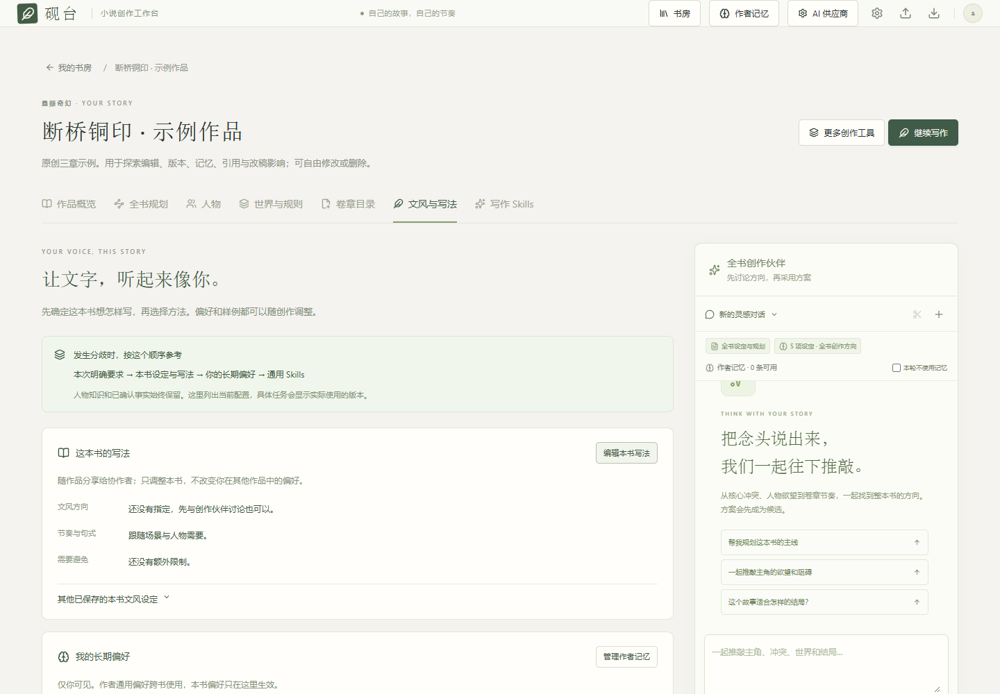
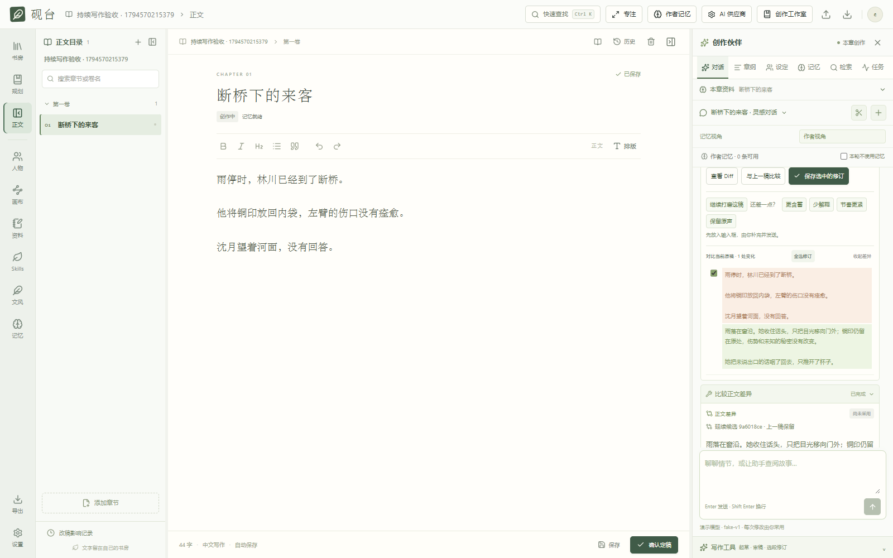
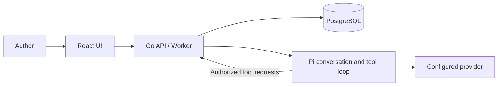

# Yantai · 砚台

**Open a book and know where you left off, what needs attention, and what to do next.**

[简体中文](README.md) · [Download v0.5.0](https://github.com/ToStarLiu/yantai-novel/releases/tag/v0.5.0) · [Quick start](#quick-start) · [Author workflow](docs/development/author-workflow.md) · [Changelog](CHANGELOG.md)

[](https://github.com/ToStarLiu/yantai-novel/actions/workflows/ci.yml)
[](LICENSE)

Yantai is a self-hosted workspace for long-form Chinese fiction. Plan a book, develop characters and world rules, then write and revise with an AI partner that can consult the book's permitted sources. Manuscripts, conversations, and candidate revisions form one workflow. The author chooses what to adopt.

**v0.5.0** introduces a simpler everyday interface, private author memory, unified writing preferences, and iterative candidate revisions. It supports a Windows x64 portable desktop package, the web, and an installable PWA. The interface is primarily in Chinese.


## Four things close to the author

- **Resume the book.** The overview shows actual saved text, final-version status, and review reminders. Each account and book has its own valid resume position in the current browser.
- **Give your voice concrete references.** Combine book requirements, your own samples, and Writing Skills on one page. Private author memory stores preferences, collaboration habits, and conversation notes across books or within one book.
- **Keep working on the same candidate.** Refine a draft, change only a selected passage, compare with its parent or the saved manuscript, and adopt the whole candidate or selected changes.
- **Keep story memory grounded.** Locations, injuries, ownership, character knowledge/belief, and foreshadowing retain manuscript evidence. Earlier revisions prompt review from the affected chapter.

AI suggestions remain candidates. Personal memories can be inspected, corrected, disabled, or forgotten. They provide editable context rather than online model training or a guarantee that prose quality will improve automatically.

## Quick start

### Windows portable desktop

Download these assets from the [v0.5.0 release](https://github.com/ToStarLiu/yantai-novel/releases/tag/v0.5.0):

| File | Purpose |
| --- | --- |
| `Yantai-v0.5.0-windows-x64.zip` | Complete Windows x64 portable directory |
| `SHA256SUMS.txt` | SHA-256 download checksums |
| `release.json` | Version and build manifest |

1. Extract the **entire ZIP** into a writable directory, then run `Yantai.exe`. Keep the complete directory when moving or distributing it.
2. First launch creates a separate data directory and random local account, then signs in automatically. The **砚台** application menu opens the data directory and local login information.
3. Open **更多 → AI 供应商** (More → AI providers) to configure your endpoint, protocol, model, and key. Until a provider is configured, the explicitly labeled demo model is for exploring the workflow.

The package includes the API, PostgreSQL, web assets, Node/Pi, and Chinese fonts. No separate developer tool installation is required. Real models and optional retrieval, cover, or voice services need their own configuration; see [known limitations](docs/release/known-limitations.md).

**Upgrading:** Locate and back up the author data directory, fully exit the old application, extract the new package into a new program directory, then launch it. Keep the original data and matching `provider-master.key`; do not replace author data with an empty directory or packaged resources. v0.4.0 → v0.5.0 includes database migrations, so reverting requires a pre-upgrade backup. See the [release notes](docs/release/v0.5.0.md#from-an-earlier-version) and [upgrade guide](deploy/upgrade.md).

### Windows web application from source

Requirements: Windows x64, PowerShell 7 (`pwsh`), Git, and network access for the initial tool and dependency downloads.

```sh
git clone https://github.com/ToStarLiu/yantai-novel.git
cd yantai-novel
```

From the repository root, preserve an existing `.env`. On first use, copy the example and set `AUTHOR_PASSWORD` to at least 12 characters:

```powershell
if (-not (Test-Path -LiteralPath .env)) { Copy-Item .env.example .env }
notepad .env
pwsh -File scripts/setup-dev.ps1
pwsh -File scripts/start.ps1
```

Open [http://127.0.0.1:8088](http://127.0.0.1:8088) and sign in with your configured credentials. The default username is `author`.

- Tools install into `.tools/` without changing the permanent PATH or installing a database service.
- The start script builds the UI and Pi harness, applies explicit migrations, and starts the local service. Use `-SkipBuild` when the existing builds are current.
- Development PostgreSQL listens on loopback and stores data under `.local/pgdata`. This configuration is not intended for direct public network exposure.
- To add the original three-chapter example, load the environment in another PowerShell window and run `go run ./cmd/seed`. Seeding does not call a model.

See the [toolchain guide](docs/development/toolchain.md) for pinned versions and verification. Docker Compose, HTTPS, reverse proxies, and independent workers are described in [deployment](deploy/README.md); the Compose path still needs independent verification in the target environment.

## Start with one book

1. **Library → plan a book.** Begin with an idea or import an existing manuscript. A book can have an AI planning conversation before any chapters exist.
2. **Book overview.** See progress, at most three items needing attention, and one next action. Resume this book's chapter or jump to the chapter named by the memory review queue.
3. **Settings and planning.** Open book direction, characters, world rules, or **文风与写法** (Voice and Writing) as needed. **和 AI 讨论** opens the book-level writing partner.
4. **Write.** Navigate chapters on the left, edit in the center, and use **对话 / 本章资料 / 记录** (Conversation / Chapter materials / Records) on the right. Tools and **更多** hold less frequent actions.
5. **Refine and adopt.** Bring a manuscript selection into the conversation, continue a candidate revision, inspect differences, and choose changes to adopt. Preparing a message does not call a model; adoption creates a new manuscript version.

Collapse side panels, enter focus mode, adjust reading preferences, or use quick actions (`Ctrl/Cmd+K`). Switching sections or collapsing a discussion within the same book page preserves its draft. Unsaved forms are checked before leaving or creating a chapter. Resume and reading preferences belong to the current browser and do not automatically synchronize across devices.

<details>
<summary>Book overview, voice settings, and iterative revision screenshots</summary>






[Mobile book overview](docs/release/screenshots/simplified-book-mobile.png) · [Mobile manuscript](docs/release/screenshots/simplified-workspace-mobile.png)

</details>

[Author workflow](docs/development/author-workflow.md) · [Iterative revisions and adoption](docs/development/writing-flow.md)

## Writing Skills and author memory

Manage book requirements, private samples, and guides under **设定与规划 → 文风与写法**, or open **更多 → 写作 Skills / 作者记忆** for the dedicated managers.

| Material | Use |
| --- | --- |
| Book writing requirements | Voice, pacing, and expressions to avoid; shared with the book's collaborators |
| Your own samples | A short passage you wrote, with notes on the phrasing, dialogue, or emotional restraint to preserve |
| Writing Skills | Preview Markdown, ZIP, pinned GitHub sources, or JSON packages; choose book/task scope, priority, versions, and exports |
| Author memory | Private cross-book or book-specific preferences; confirm suggestions, inspect actual usage, disable, or forget |

Five original Chinese starter templates and six open-source guides with source/license previews are available. Start with one to three complementary guides and your own examples. Imported scripts, CLI commands, and third-party agents are not executed.

The writing partner reads guides and relevant memories in bounded pages as needed. Turns and tasks freeze their selected versions; changes invalidate outdated candidates. Drafting, rewriting, planning, and batch creation can use author preferences, while factual review and extraction exclude personal taste. **记住这句话** lets you review and save one of your messages; a new memory proposed by the assistant needs author confirmation.

[Skill behavior](docs/development/writing-skills.md) · [Open-source guide research](docs/release/writing-skills-research.md) · [Memory and privacy boundaries](docs/development/author-memory.md)

## More tools when needed

| Area | Features |
| --- | --- |
| Planning and organization | Book/volume/chapter plans, scenes, character arcs, story canvas, references, story wiki |
| Memory and retrieval | Manuscript evidence, character knowledge boundaries, revision impact, keyword retrieval, optional embeddings/reranking |
| Jobs and workflows | Recoverable tasks, versioned prompts/agents, review gates, chapter batches, candidate reviews, rule-based sandbox, branches |
| Collaboration and publishing | Roles, invitations, comments, presence; project packages and Markdown/TXT/DOCX/EPUB/PDF/HTML exports |
| Models and integrations | UI provider configuration, Chat Completions/Responses-compatible services, native Ollama, read-only MCP, source research, cover/TTS adapters |

Usage, task state, and estimated costs are visible. Unknown costs stay unknown; estimates are not provider invoices. Check compatibility against your selected services. Literary quality, editing time, and long-term voice effects still require evaluation with actual authors and manuscripts.

## Data, privacy, and backups

Books and execution records live in your PostgreSQL instance. External model calls send the required manuscript, settings, selected memories, and Skills to your configured provider. Optional retrieval and media integrations receive their relevant inputs.

UI provider credentials are encrypted with AES-GCM on the backend and are not returned by read APIs. **Keep the matching provider master key with database backups.** Responses calls set `store:false`; the provider's retention policy remains the provider's responsibility.

Author memory and private inputs are account-scoped and excluded from single-book exports. Generated candidates and adopted manuscripts remain shared according to book permissions. Full-instance backups include private memories, conversations, and frozen task inputs. Forgetting removes a long-term entry and old active context; it does not erase every historical conversation, draft, or backup.

For source-run instances:

```powershell
pwsh -File scripts/backup.ps1
```

A single-book JSON package is for moving a book, not replacing a full-instance backup. Restore writes to a new isolated database and quarantines queues that might otherwise trigger external calls.

[Backup and restore](deploy/backup-restore.md) · [Project package scope](docs/release/project-archive.md) · [Upgrade and rollback](deploy/upgrade.md)

## Architecture and development



Go owns permissions, manuscript/setting versions, story evidence, budgets, execution history, and adoption. Pi handles conversations and the tool loop. Context separates current sources, on-demand material, recent dialogue, and derived summaries; summaries, guides, and preferences do not automatically become story facts or permissions.

Dependencies are pinned in `go.mod`/`go.sum` and each directory's `package-lock.json`. After environment setup:

```powershell
. ./scripts/dev.ps1 -Action env
# Create a dedicated test database first; each test uses and removes a random schema.
$env:TEST_DATABASE_URL = 'postgres://novel@127.0.0.1:55432/novel_test?sslmode=disable'
go test ./... -count=1 -timeout=420s
go vet ./...
npm --prefix web run typecheck
npm --prefix web run test -- --run
npm --prefix web run build
npm --prefix harness run build
npm --prefix harness test
```

Tests skipped without `TEST_DATABASE_URL` do not establish database correctness. Browser E2E requires a separate demo service rather than an author's everyday instance. See [desktop/README.md](desktop/README.md) for desktop packaging.

The latest interaction iteration recorded **47 complete Chrome cases**, **16 frontend unit tests**, and a database test for real text-presence summaries. Earlier author-context and revision iterations also have Go/Pi and restore records. The [acceptance log](docs/release/acceptance.md) separates each run's scope and desktop release verification instead of presenting historical results as one new full run.

## Documentation and contributing

Most detailed documentation is in Chinese:

- [Author workflow](docs/development/author-workflow.md), [revisions](docs/development/writing-flow.md), [Skills](docs/development/writing-skills.md), and [author memory](docs/development/author-memory.md).
- [Deployment](deploy/README.md), [upgrade](deploy/upgrade.md), and [recovery](deploy/recovery-drill.md).
- [Providers](docs/development/provider-settings.md), [context](docs/development/copilot-context.md), [CI](docs/development/ci.md), and [OpenAPI](api/openapi.yaml).
- [Known limitations](docs/release/known-limitations.md), [reference comparison](docs/release/reference-advantages.md), [acceptance](docs/release/acceptance.md), and [retrieval baseline](evaluation/retrieval-baseline.md).

Contributions and author feedback are welcome. Read [CONTRIBUTING.md](CONTRIBUTING.md) first. Follow [SECURITY.md](SECURITY.md) for vulnerabilities; keep keys and private manuscripts out of public issues.

## License and acknowledgments

Yantai is licensed under **GPL-3.0-only**. See [LICENSE](LICENSE). Dependencies, fonts, Pi components, and imported third-party Skills retain their own licenses and notices; see the [license inventory](docs/licenses.md).

Thanks to Pi, React, Tiptap, React Flow, PostgreSQL, pgx, and the authors who share writing tools and methods. The [reference comparison](docs/release/reference-advantages.md) documents the ideas adopted and their independently implemented scope.
