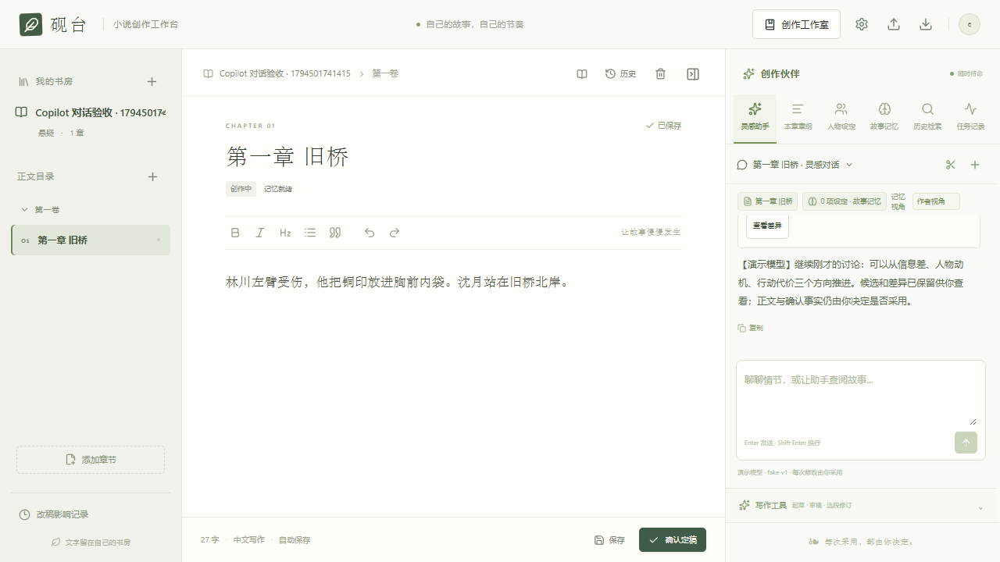
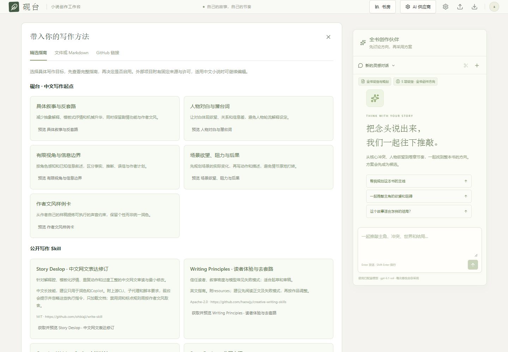
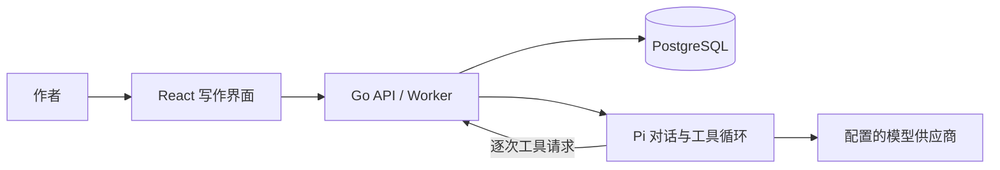

# 砚台 · Yantai

**从一个念头，到一本有自己声音的小说。**

[English](README.en.md) · [快速开始](#快速开始) · [写作 Skills](#写作-skills) · [部署文档](deploy/README.md) · [更新记录](CHANGELOG.md)

砚台是面向中文长篇小说的自托管创作工作台。先在书房规划作品，再整理人物、世界与卷章；写作时，与能读取本书资料的 AI 创作伙伴连续讨论、生成候选、比较 Diff，由作者决定采用。

[](https://github.com/ToStarLiu/yantai-novel/actions/workflows/ci.yml)
[](LICENSE)

当前版本 **0.4.0**，提供 Web、可安装 PWA 和 Windows 便携桌面构建。核心技术为 Go、React/TypeScript、PostgreSQL 与 Pi。


## 为什么做砚台

长篇写作需要的不只是一次续写。砚台把作品规划、正文版本、叙事记忆与作者选择放在同一条创作流程里：

- **先规划，再写作。** 零章节也能讨论全书方向，逐步整理核心冲突、人物、世界和卷章。
- **保留作者决定权。** AI 改稿和规划先成为独立候选，逐项比较、明确采用；正文保留不可变版本和并发冲突保护。
- **让记忆有出处。** 人物位置、伤势、物品归属、已知/误信与伏笔绑定正文证据，修改旧稿后提示后续影响。
- **让写法可配置。** 每本书选择自己的写作 Skills、文风与任务用途，避免所有作品套用同一份提示词。
- **看得见执行与费用。** 工具活动、输入来源、任务状态、Token 用量和费用估算可查；未知费用保持未知。

模型文学质量、作者修改时间和长期文风一致性仍需要实际作品评估。工程验收不代表小说已经达到某种文学标准。

## 可以做什么

| 创作环节 | 能力 |
| --- | --- |
| 书房与规划 | 多作品、新书向导、全书/卷/章规划、人物与世界设定、情节画布、场景与人物弧 |
| 正文与改稿 | 中文富文本、自动保存与失败缓冲、不可变版本、选段扩写/压缩/润色、候选 Diff 与逐项采用 |
| 创作伙伴 | Pi 多轮工具调用、流式输出、刷新续读、停止、上下文整理，支持章节和零章节全书对话 |
| 写作 Skills | Markdown/ZIP/GitHub/JSON 导入预览、按书和任务启用、优先级、整包换版、导出复用 |
| 记忆与检索 | 带证据的五类叙事记忆、人物知识边界、旧稿影响、关键词检索及可选 Embedding/Rerank |
| 进阶工作流 | 版本化 Prompt/Agent、持久 DAG、人工闸门、批量章节候选、多候选审稿、规则沙盘与分支 |
| 协作与出版 | 成员角色、邀请、批注和在线状态；作品包迁移、Markdown/TXT/DOCX/EPUB/PDF/HTML 导出 |
| 外部能力 | 多供应商配置、只读 MCP、资料研究，以及需单独配置供应商的封面和 TTS |

详细行为与边界见 [验收记录](docs/release/acceptance.md)、[参考项目优势对照](docs/release/reference-advantages.md) 和 [已知限制](docs/release/known-limitations.md)。



## 快速开始

### Windows 本机运行

需要 Windows x64、PowerShell 7（`pwsh`）和 Git。首次准备需要联网下载工具与依赖。

先克隆仓库，再进入项目目录：

```sh
git clone https://github.com/ToStarLiu/yantai-novel.git
cd yantai-novel
```

在项目根目录执行，已有 `.env` 时保留原文件：

```powershell
if (-not (Test-Path -LiteralPath .env)) { Copy-Item .env.example .env }
notepad .env
```

在 `.env` 中设置 `AUTHOR_PASSWORD`，至少 12 个字符；用户名默认是 `author`。模型连接可以暂时留空，启动后在页面配置。

```powershell
pwsh -File scripts/setup-dev.ps1
pwsh -File scripts/start.ps1
```

打开 [http://127.0.0.1:8088](http://127.0.0.1:8088)，使用自己配置的账户登录。

- `setup-dev.ps1` 将固定版本的 Go、Node.js、sqlc 与 PostgreSQL 安装到项目内 `.tools/`，不修改永久 PATH，不安装系统数据库服务。
- `start.ps1` 启动本机数据库、构建 Web 与 Pi、显式应用迁移，再启动服务。后续已有构建可加 `-SkipBuild`。
- 默认 `APP_PROVIDER=auto`。模型地址、密钥与模型名全空时使用明确标识的演示模型；它用于探索流程，不能用来判断生成质量。保存并启用页面供应商后即可使用真实模型。
- 本机数据库只监听回环地址，数据位于 `.local/pgdata`。不要将这个开发数据库配置直接暴露到公网。

可选：在另一个 PowerShell 窗口添加仓库内的原创三章示例，不调用模型：

```powershell
. ./scripts/dev.ps1 -Action env
go run ./cmd/seed
```

工具固定版本与下载校验见 [工具链说明](docs/development/toolchain.md)。

### Docker Compose

仓库提供 PostgreSQL、迁移、API 与独立 Worker 的 Compose 配置。**该路径尚未在本项目的本机验收环境实跑**，部署前请独立核验。

复制 `.env.example` 为 `.env`，至少配置：

- `AUTHOR_PASSWORD`：至少 12 个字符。
- `POSTGRES_PASSWORD`：建议使用至少 32 个字符的随机十六进制字符串；当前 Compose 会将它插入数据库 URL。
- `PUBLIC_ORIGIN=http://127.0.0.1:8088`：浏览器访问地址必须与它完全一致。

```sh
docker compose --env-file .env -f deploy/compose.yaml up --build -d
docker compose --env-file .env -f deploy/compose.yaml ps
```

然后访问 [http://127.0.0.1:8088](http://127.0.0.1:8088)。便携数据库与 Compose 默认都使用本机 55432 端口，请选择一种方式运行。

远程部署、HTTPS、反向代理和持久卷说明见 [部署文档](deploy/README.md)。

## 配置 AI 供应商

登录后，在书房顶栏打开 **AI 供应商**，填写地址、协议、模型与密钥，发现可用模型并选择默认连接。供应商页面支持 Chat Completions 和 Responses 兼容接口；高级配置还提供原生 Ollama、按任务路由和检索服务。

也可通过 `.env` 配置：

```dotenv
LLM_BASE_URL=
LLM_API_KEY=
LLM_MODEL=
LLM_WIRE_API=responses
```

使用环境连接时，填写与服务匹配的完整配置；不要把 API 密钥放进仓库、截图或 Issue。各模型的输入/输出价格需按自己的服务配置，金额是估算而非账单；没有价格时显示 Unknown，启用金额预算会阻止未定价调用。

Embedding、Rerank、搜索、封面与 TTS 依赖各自的真实服务配置；未配置时不会用演示结果冒充成功。详见 [供应商设置](docs/development/provider-settings.md) 和 [.env.example](.env.example)。

## 写作 Skills

在 **书籍概览 → 写作 Skills** 管理本书的指南，章节工作台也提供入口。

1. 选择内置模板、粘贴 Markdown、上传 `SKILL.md`/ZIP/JSON 资料包，或输入 GitHub Skill 链接。
2. 查看正文、参考文件、来源、许可证和兼容性提示，确认后才保存。
3. 设置用途、优先级和开关；建议先启用 1–3 个互补指南，再结合自己的写作样例调整。
4. 编辑保存新版本，或重新导入同名完整资料包升级；可导出后用于另一本书。

内置五套原创中文起步模板：具体叙事、人物对白、有限视角、场景推进、作者文风样例卡。精选目录另收录六项固定提交的开源指南，包括 Story Deslop、Writing Principles、Scene Craft 等，来源与许可证均可预览。

Copilot 按需分页读取指南和引用资料，每轮冻结所用版本；修改规则后，旧候选不能直接覆盖新的要求。导入资料中的脚本、CLI 或第三方代理命令不会执行。普通单次生成完整加载主规则，超过 6000 字时会明确提示精简或改用 Copilot。



[Skill 使用与架构](docs/development/writing-skills.md) · [开源指南调研](docs/release/writing-skills-research.md)

## 架构与上下文



Go 管作品权限、正文与设定版本、故事事实、预算、执行记录和作者采用。Pi 管连续对话与工具循环；工具只能通过 Go 的业务边界访问资料或创建候选。

上下文区分作者要求、当前权威来源、按需工具资料、近期对话与派生摘要。旧版本资料会退出活动上下文，引用事实仍需回到有效正文；摘要和技能建议不会自动变成已确认事实。详见 [上下文工程](docs/development/copilot-context.md)。

```text
cmd/api/             HTTP、SSE 与 Web 入口
cmd/worker/          独立后台执行入口
internal/workbench/  作品、版本、记忆、检索、任务及创作工具
internal/server/     会话、CSRF、成员权限与 API
harness/             Pi 工具循环、流式输出与上下文整理
migrations/          显式 PostgreSQL 迁移
web/                 React/TypeScript 界面
desktop/             Windows Electron 便携包装
```

## 数据、隐私与备份

作品与运行记录保存在自己的 PostgreSQL 中。调用外部模型时，所需正文、设定、允许读取的记忆和启用的 Skill 会发送给所选服务；使用外部检索或媒体服务时，相应资料也会发送给对应供应商。

页面保存的供应商凭据在后端用 AES-GCM 加密，读取接口不返回密钥。主密钥独立保存；环境配置仍在本机 `.env` 中。Responses 请求设置 `store:false`，服务商自己的数据保留政策仍由服务商决定。

```powershell
pwsh -File scripts/backup.ps1
```

备份数据库时需同时保留匹配的供应商主密钥。恢复脚本只写入新的隔离库，并隔离可能触发外部调用的队列。单作品 JSON 包可迁移正文、设定、当前 Skills 和故事资料；它不代替全实例备份，也不包含登录或供应商密钥。

[备份恢复](deploy/backup-restore.md) · [作品包覆盖范围](docs/release/project-archive.md) · [升级流程](deploy/upgrade.md)

## Windows 便携桌面

可在 [GitHub Releases](https://github.com/ToStarLiu/yantai-novel/releases) 下载 Windows x64 便携包与校验信息。

桌面包装可携带 PostgreSQL、Go API、Web、Node/Pi 和中文字体。首次运行创建独立数据目录与随机账户并自动登录，菜单可打开数据和登录信息；程序更新时保留作者数据。它不会打包开发者的 `.env` 或作品库。

完成 Windows 工具准备后，可从源码构建：

```powershell
. ./scripts/dev.ps1 -Action env
go build -o .tools/api-advanced-next.exe ./cmd/api
npm --prefix web ci
npm --prefix web run build
npm --prefix harness ci
npm --prefix harness run build
npm --prefix harness run bundle
npm --prefix desktop ci
npm --prefix desktop run package
```

产物为 `desktop/dist/Yantai-win32-x64/Yantai.exe`，分发时需要整个目录。桌面构建产物不纳入 Git。PWA 可从浏览器安装，离线缓存仅保留界面静态资源，保存与生成仍需连接服务。

## 开发与验证

依赖版本由 `go.mod`/`go.sum` 和各目录的 `package-lock.json` 固定。Windows 工具准备与数据库启动后：

```powershell
. ./scripts/dev.ps1 -Action env
go test ./... -count=1
go vet ./...
npm --prefix web ci
npm --prefix web run typecheck
npm --prefix web run test -- --run
npm --prefix web run build
npm --prefix harness ci
npm --prefix harness run build
npm --prefix harness test
```

真实数据库集成测试需要 `TEST_DATABASE_URL`，每项测试创建并清理独立随机 schema。没有设置时会明确跳过；不能将跳过等同于数据库验证通过。浏览器 E2E 需先准备独立演示测试服务与账户，配置见 [Playwright](web/playwright.config.ts) 和 [前端验收](docs/release/frontend-verification.md)。

0.4.0 的验收记录包含 205 项后端测试、Pi 源码与独立 bundle 各 19 项测试、5 项前端单测及本轮 8 项受影响浏览器用例；另外完成了桌面导入/执行/重启与非空备份恢复。命令、历史覆盖范围与限制见 [验收记录](docs/release/acceptance.md)。这些结果不代表容器部署或文学质量已经通过评估。

欢迎提交可复现的问题、测试和改进，开始前请阅读 [贡献指南](CONTRIBUTING.md)。安全问题请遵循 [安全说明](SECURITY.md)，不要在公开 Issue 中提交密钥或私密原稿。

## 文档与后续方向

| 主题 | 文档 |
| --- | --- |
| 部署、升级、恢复 | [部署](deploy/README.md) · [升级](deploy/upgrade.md) · [恢复演练](deploy/recovery-drill.md) |
| 产品与执行边界 | [已知限制](docs/release/known-limitations.md) · [参考优势对照](docs/release/reference-advantages.md) |
| AI 与上下文 | [供应商](docs/development/provider-settings.md) · [上下文](docs/development/copilot-context.md) · [Skills](docs/development/writing-skills.md) |
| 持续集成 | [CI 工作流说明](docs/development/ci.md) |
| 设计与接口 | [阶段计划](docs/superpowers/plans/2026-11-12-novel/README.md) · [设计](docs/superpowers/specs/2026-11-12-novel-workbench-design.md) · [OpenAPI](api/openapi.yaml) |
| 质量与检索评估 | [模型基线](evaluation/baseline-status.md) · [检索基线](evaluation/retrieval-baseline.md) · [验收](docs/release/acceptance.md) |

后续重点是实际作者试用、基于作者样例的文风效果比较、长篇检索与复杂时间线回归，以及不同部署环境的验证。当前协作采用版本冲突保护，尚无 CRDT/OT 逐字合并；沙盘是确定性规则模拟；第三方媒体、搜索和模型兼容性需要按所选服务验证。

## 许可证与致谢

本项目采用 **GPL-3.0-only** 授权，完整条款见 [LICENSE](LICENSE)。依赖、字体、Pi 运行时及导入的第三方 Skills 保留各自的许可证与版权说明，见 [依赖许可证清单](docs/licenses.md)。

感谢 Pi、React、Tiptap、React Flow、PostgreSQL、pgx 等项目，以及公开分享写作方法与创作工具的作者。参考项目的吸收范围与独立实现说明见 [优势对照](docs/release/reference-advantages.md)。
