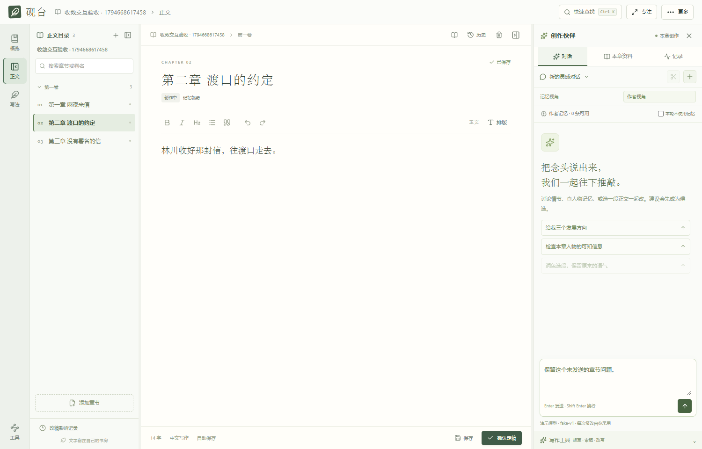
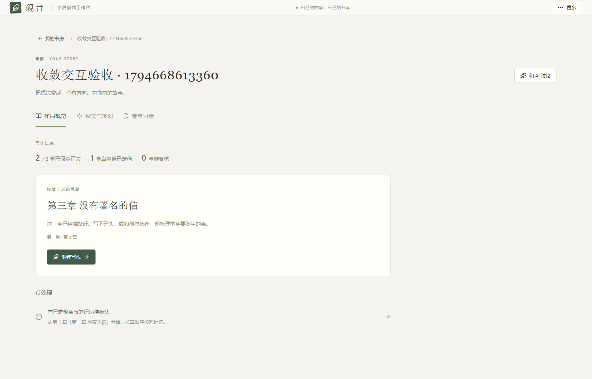
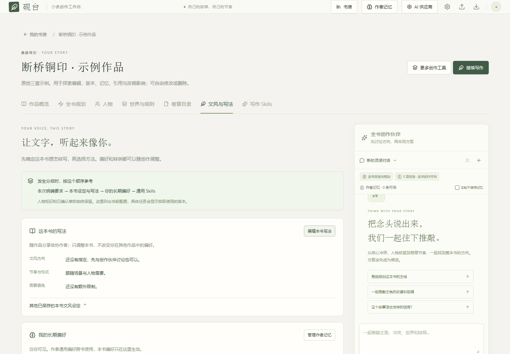
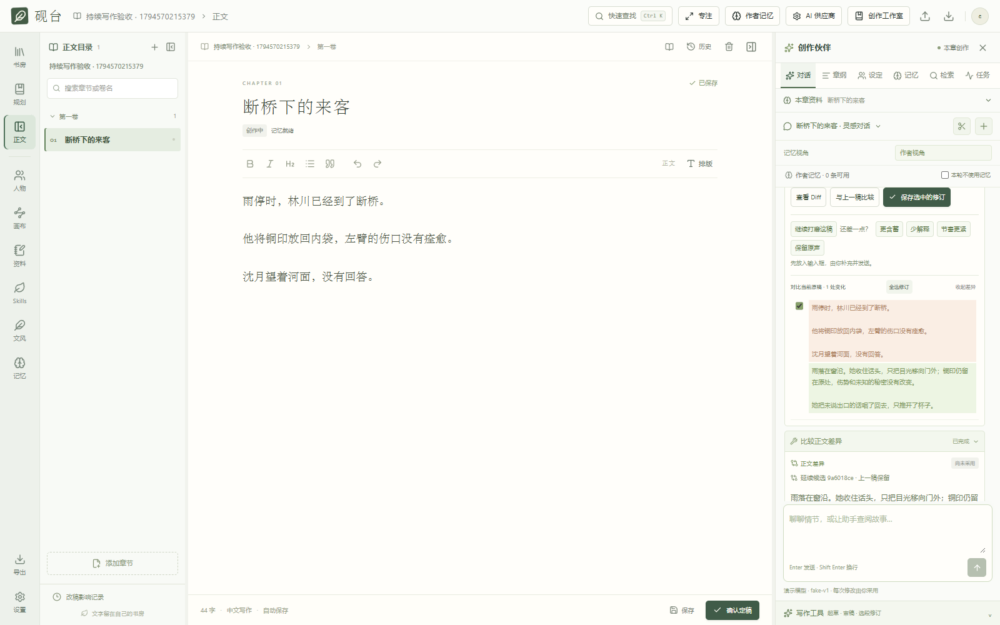
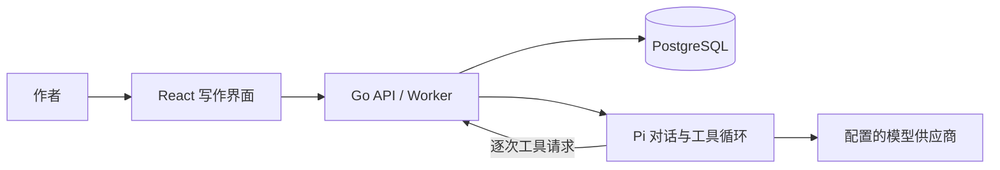

# 砚台 · Yantai

**写到哪里、还有什么待处理、下一步做什么，打开书就知道。**

[English](README.en.md) · [下载 v0.5.0](https://github.com/ToStarLiu/yantai-novel/releases/tag/v0.5.0) · [快速开始](#快速开始) · [使用流程](docs/development/author-workflow.md) · [更新记录](CHANGELOG.md)

[](https://github.com/ToStarLiu/yantai-novel/actions/workflows/ci.yml)
[](LICENSE)

砚台是面向中文长篇小说的自托管创作工作台。规划一本书，整理人物和世界，再与能查阅本书资料的 AI 创作伙伴一起写、一起改。正文、对话和候选修改放在同一条创作流程里，采用哪一稿由作者决定。

**v0.5.0** 带来更简洁的日常界面、私有作者记忆、统一文风设置和连续改稿。提供 Windows x64 便携桌面包，也可运行 Web 或安装为 PWA。



## 为作者保留的四件事

- **随时接着写。** 作品概览显示实际正文与定稿进度、待复核事项；在当前浏览器中按账号和作品恢复上次打开的有效章节。
- **让写法有自己的依据。** 在“文风与写法”集中管理本书要求、自己的文字样例与写作 Skills；私人作者记忆记录跨书偏好、合作习惯和对话要点。
- **在同一份候选上打磨。** 继续修改上一稿、只改其中一段、比较上一稿或当前原稿，再选择整稿或逐段采用。
- **让故事记忆有出处。** 人物位置、伤势、物品归属、已知与误信、伏笔绑定正文证据；前文改变后，提醒从需要处理的章节开始核对。

AI 建议先保留为候选。偏好记忆可查看、纠正、关闭和忘记；它是可修正的上下文参考，不是在线训练，也不保证生成质量自动提高。

## 快速开始

### 直接使用 Windows 便携版

在 [v0.5.0 Release](https://github.com/ToStarLiu/yantai-novel/releases/tag/v0.5.0) 下载：

| 文件 | 用途 |
| --- | --- |
| `Yantai-v0.5.0-windows-x64.zip` | Windows x64 完整便携目录 |
| `SHA256SUMS.txt` | 下载文件的 SHA-256 校验值 |
| `release.json` | 版本与构建清单 |

1. 将 ZIP **完整解压**到可写目录，运行其中的 `Yantai.exe`。分发或移动时保留整个目录。
2. 首次运行会创建独立数据目录、随机本机账户并自动登录；菜单“砚台”可打开数据目录和本机登录信息。
3. 在右上角 **更多 → AI 供应商** 配置自己的地址、协议、模型和密钥，再开始创作。未配置时使用明确标注的演示模型，仅用于体验流程。

便携包携带 API、PostgreSQL、Web、Node/Pi 和中文字体，无需另外安装开发工具。真实模型及可选检索、封面、语音能力需要各自的服务配置；具体支持范围见[已知限制](docs/release/known-limitations.md)。

**从旧版升级：** 先定位并备份作者数据目录，完全退出旧版，将新包解压到新的程序目录，再启动新版。数据目录独立于程序目录，保留原数据及 `provider-master.key`；不要把空白新目录或打包资源覆盖到作者数据上。v0.4.0 到 v0.5.0 包含数据库迁移，回退需要升级前备份，详见[发布说明](docs/release/v0.5.0.md#从旧版升级)与[升级流程](deploy/upgrade.md)。

### 从源码运行 Windows Web 版

需要 Windows x64、PowerShell 7（`pwsh`）和 Git；首次准备需要联网下载工具与依赖。

```sh
git clone https://github.com/ToStarLiu/yantai-novel.git
cd yantai-novel
```

在项目根目录保留已有 `.env`，首次使用时复制并设置至少 12 字符的 `AUTHOR_PASSWORD`：

```powershell
if (-not (Test-Path -LiteralPath .env)) { Copy-Item .env.example .env }
notepad .env
pwsh -File scripts/setup-dev.ps1
pwsh -File scripts/start.ps1
```

打开 [http://127.0.0.1:8088](http://127.0.0.1:8088)，使用自己配置的账户登录，默认用户名为 `author`。

- 工具安装在项目内 `.tools/`，不修改永久 PATH，也不安装系统数据库服务。
- 启动脚本构建 Web 与 Pi、显式应用迁移，再启动本机服务；已有最新构建时可加 `-SkipBuild`。
- 本机数据库只监听回环地址，数据位于 `.local/pgdata`。这个开发配置不用于直接暴露公网。
- 可在第二个 PowerShell 窗口加载环境后运行 `go run ./cmd/seed`，添加仓库内的原创三章示例，不调用模型。

工具版本与校验见[工具链说明](docs/development/toolchain.md)。Docker Compose、HTTPS、反向代理和独立 Worker 见[部署文档](deploy/README.md)；Compose 路径仍需在目标环境独立验证。

## 从一本书开始

1. **书房 → 规划一本新书。** 先写下想法，也可导入已有作品；没有章节时就能和 AI 讨论整本书。
2. **作品概览。** 只看写作进度、最多三条待处理和下一步。“继续写作”恢复本书位置；记忆提醒直达后台队列里需要核对的章。
3. **设定与规划。** 按需整理全书方向、人物、世界与规则、文风与写法。全书创作伙伴点击“和 AI 讨论”后展开。
4. **进入正文。** 左侧定位卷章，中间写作，右侧只有“对话、本章资料、记录”。画布、出版等能力从工具或“更多”进入。
5. **推敲与采用。** 选中正文可把问题带入对话；候选可继续打磨、查看差异、逐段采用。未发送的选段要求不会自动调用模型，采用才生成正文新版本。

目录和助手可收起，支持专注模式、正文排版和快捷操作（`Ctrl/Cmd+K`）。同一作品页内切换资料或收起讨论保留草稿；离开作品与创建章节前，未保存表单会先要求处理。最近章节与排版偏好保存在当前浏览器，不承诺跨设备自动同步。

<details>
<summary>查看作品概览、文风设置与连续改稿截图</summary>







[手机作品概览](docs/release/screenshots/simplified-book-mobile.png) · [手机正文](docs/release/screenshots/simplified-workspace-mobile.png)

</details>

[完整作者流程](docs/development/author-workflow.md) · [连续改稿与采用](docs/development/writing-flow.md)

## 写作 Skills 与作者记忆

在 **设定与规划 → 文风与写法** 统一管理本书要求、私人样例和 Skills；也可从 **更多 → 写作 Skills / 作者记忆** 独立打开。

| 内容 | 怎么使用 |
| --- | --- |
| 本书写法 | 设置文风、节奏和需要避免的表达，随作品分享给协作者 |
| 自己的文字样例 | 保存一小段自己的文字，并说明想保留的句式、对白或情绪表达 |
| 写作 Skills | 预览导入 Markdown、ZIP、GitHub 固定提交或 JSON 资料包，按书和任务启用、排序、换版与导出 |
| 作者记忆 | 保存跨书偏好或仅本书适用的私人记忆；确认助手建议，查看每轮使用明细，随时停用或忘记 |

内置五套原创中文起步模板，并提供六项带来源与许可证的开源指南目录。建议先选择 1–3 个互补指南，结合自己的样例调整。导入资料中的脚本、CLI 和第三方 Agent 命令不会执行。

创作伙伴按需分页读取指南和相关记忆；每轮和任务冻结所用版本，规则变化后旧候选会失效。起草、改写、章纲及批量制作可参考作者偏好，一致性审稿与事实提取排除个人偏好。自己的消息可通过“记住这句话”整理后保存，助手提出的新记忆需要作者确认。

[Skill 使用说明](docs/development/writing-skills.md) · [开源指南调研](docs/release/writing-skills-research.md) · [记忆与私有边界](docs/development/author-memory.md)

## 按需打开的其他能力

| 创作环节 | 能力 |
| --- | --- |
| 规划与整理 | 全书/卷/章规划、场景、人物弧、情节画布、参考资料、故事百科 |
| 记忆与检索 | 正文证据、人物知识边界、旧稿影响、关键词检索及可选 Embedding/Rerank |
| 任务与工作流 | 可恢复任务、版本化 Prompt/Agent、人工闸门、批量章节候选、多候选审稿、规则沙盘与分支 |
| 协作与出版 | 成员角色、邀请、批注与在线状态；作品包迁移及 Markdown/TXT/DOCX/EPUB/PDF/HTML 导出 |
| 模型与外部服务 | 页面配置多供应商、Chat Completions / Responses 兼容接口、原生 Ollama、只读 MCP、资料研究及封面/TTS 接口 |

用量、任务状态和费用估算可查；未知费用保持未知，金额不是供应商账单。模型兼容性和可选外部服务需要按所选接口验证。文学质量、修改时间和长期文风效果仍需实际作者与原稿评估。

## 数据、隐私与备份

作品与运行记录保存在自己的 PostgreSQL 中。调用外部模型时，任务所需正文、设定、所选记忆与 Skills 会发送给自己配置的服务；可选检索和媒体服务也会收到相应资料。

页面供应商密钥在后端以 AES-GCM 加密，读取接口不返回密钥。**数据库备份应同时保留匹配的供应商主密钥。** Responses 请求设置 `store:false`，服务商自身的数据保留政策仍由服务商决定。

作者记忆和私人输入按账号隔离，不随单作品包分享；生成候选和采用后的正文仍按作品权限共享。完整实例备份包含私人记忆、对话与任务快照，应按私密资料保存。“忘记”移除长期条目和旧活动上下文，不会物理删除所有历史对话、稿件与已有备份。

源码实例可执行：

```powershell
pwsh -File scripts/backup.ps1
```

单作品 JSON 包适合迁移一本书，不能代替全实例备份；恢复脚本只写入新的隔离库，并隔离可能触发外部调用的队列。

[备份恢复](deploy/backup-restore.md) · [作品包范围](docs/release/project-archive.md) · [升级与回退](deploy/upgrade.md)

## 架构与开发



Go 管作品权限、正文与设定版本、事实证据、预算、执行记录和作者采用；Pi 管连续对话与工具循环。上下文按当前来源、按需资料、近期对话与派生摘要组织；摘要、Skill 和偏好不能自动成为故事事实或权限。

依赖版本由 `go.mod`/`go.sum` 和各目录的 `package-lock.json` 固定。环境准备好后：

```powershell
. ./scripts/dev.ps1 -Action env
# 数据库测试需要指向专用测试库；每项创建并清理随机 schema。
$env:TEST_DATABASE_URL = 'postgres://novel@127.0.0.1:55432/novel_test?sslmode=disable'
go test ./... -count=1 -timeout=420s
go vet ./...
npm --prefix web run typecheck
npm --prefix web run test -- --run
npm --prefix web run build
npm --prefix harness run build
npm --prefix harness test
```

测试库须预先创建；缺少 `TEST_DATABASE_URL` 时的跳过不能视为数据库验证通过。浏览器 E2E 使用独立演示服务，勿指向作者日常实例。桌面打包和使用说明见 [desktop/README.md](desktop/README.md)。

最新交互收敛记录包含完整 **47 项 Chrome 用例**、**16 项前端单测**及正文汇总的数据库专项；此前作者上下文与连续改稿也有 Go/Pi 与备份恢复记录。各轮执行范围、发行包验收和未验证事项见[验收记录](docs/release/acceptance.md)，不将不同轮次的历史结果合并成一次全量通过。

## 文档与参与

| 主题 | 文档 |
| --- | --- |
| 作者操作 | [工作流](docs/development/author-workflow.md) · [连续改稿](docs/development/writing-flow.md) · [Skills](docs/development/writing-skills.md) · [作者记忆](docs/development/author-memory.md) |
| 部署与数据 | [部署](deploy/README.md) · [升级](deploy/upgrade.md) · [恢复演练](deploy/recovery-drill.md) |
| AI 与工程 | [供应商](docs/development/provider-settings.md) · [上下文](docs/development/copilot-context.md) · [CI](docs/development/ci.md) · [OpenAPI](api/openapi.yaml) |
| 范围与评估 | [已知限制](docs/release/known-limitations.md) · [参考优势对照](docs/release/reference-advantages.md) · [验收](docs/release/acceptance.md) · [检索基线](evaluation/retrieval-baseline.md) |

欢迎提交可复现的问题与作者使用反馈，开始前请阅读[贡献指南](CONTRIBUTING.md)。安全问题请遵循[安全说明](SECURITY.md)，不要在公开 Issue 中提交密钥或私密原稿。

## 许可证与致谢

本项目采用 **GPL-3.0-only** 授权，完整条款见 [LICENSE](LICENSE)。依赖、字体、Pi 运行时及导入的第三方 Skills 保留各自的许可证与版权说明，见[依赖许可证清单](docs/licenses.md)。

感谢 Pi、React、Tiptap、React Flow、PostgreSQL、pgx 等项目，以及公开分享写作方法与创作工具的作者。参考项目的吸收范围与独立实现说明见[优势对照](docs/release/reference-advantages.md)。
