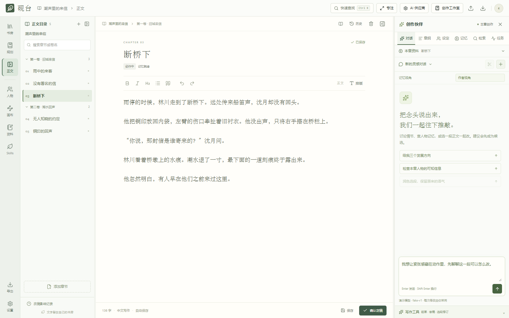

# 工作台布局与交互调整

初版日期：2026-11-13；交互收敛更新：2026-11-14。

初版参考[墨枢官网](https://ms.moshu-novel.com/)公开展示的工作台截图，使用砚台现有组件独立实现窄导航、卷章目录、居中正文和右侧创作伙伴。本轮进一步减少重复入口，把作品进度和写作动作放在前面。作品首页的规则见[作者工作流](author-workflow.md)。

## 当前入口

- 作品首页只保留“作品概览、设定与规划、卷章目录”三个主入口。概览显示真实章节进度、继续写作和最多三条待处理事项；全书对话从“和 AI 讨论”按需展开。
- 写作页左栏保留“概览、正文、写法”，底部“工具”打开现有创作工作室。画布、人物弧、参考资料、出版和批量流程仍可使用。
- 顶栏将作者记忆、AI 供应商、作品设置、Skills、导入导出和账户操作集中到“更多”。写作页保留快速查找与专注按钮。书房的供应商引导也可打开配置。
- 创作伙伴只有“对话、本章资料、记录”三个主入口。章纲、人物与设定、故事记忆和检索位于“本章资料”内部；生成结果和历史任务位于“记录”。资料概况按需展开。
- 单次起草、审稿和改写放在对话下方的“写作工具”内。普通对话保留为默认入口，候选可以直接继续打磨、比较和采用。

## 写作操作

- 目录可按章节或卷名搜索、按卷折叠；目录与助手可收起。桌面分隔条支持拖动和键盘左右/Home/End，面板宽度在本机保存并按屏宽限制。
- 专注写作收起两侧面板，Escape 或退出按钮返回；Ctrl/Cmd+Shift+F 切换，Ctrl/Cmd+S 保存。
- Ctrl/Cmd+K 或顶栏快速查找打开快捷操作，中文搜索章节与工具，方向键/Enter 选择，Escape 退出。跳转先保存正文；失败保留当前稿件并显示错误。完整作品 JSON 包可从“更多”或快捷操作导出。
- 正文排版支持字号、行距、宋体/黑体，并在本机记住偏好，只影响显示。选段浮条的讨论、扩写、润色和压缩会将要求加入助手草稿，由作者发送。
- 切换助手资料、记录或收起面板保留未发送的对话草稿；返回对话继续输入。普通候选可带回对话继续打磨，不需要把候选正文重新复制进输入框。
- 窄屏以抽屉打开目录和助手，关闭后隔离键盘焦点。“更多”支持键盘上下/Home/End、Escape 和点击外部关闭。

## 数据与保护

界面收敛调整入口和展示顺序，不改变 Go 中的权限、版本、证据、预算和作者采用规则。高级工具按需打开，能力继续保留。已保存正文的章节数根据作品详情只读 hasText 标记计算（当前版本纯文本去空白后非空）；新建章节自带的空白版本不计入。没有最近位置时，继续写作优先最后有正文内容的章节，再回到第一章。

记忆提醒独立读取实际队列：MemoryPending 使用 /state.pendingChapterIds，RebuildRequired 使用 /rebuild.chapterIds，定位最早的有效定稿章。只有响应作品与 epoch 匹配时才跳转；读取中禁用入口，失败或清单变化可重试刷新，不用最近写作章节代替。

正文自动保存及导航前保存沿用现有冲突保护。本书规划、人物/世界设定、文风编辑和未提交的章节标题有保留或离开确认；具体边界见[作者工作流](author-workflow.md)。最近写作位置属于按账户、按书保存在当前浏览器的偏好，不作为服务器的创作进度或跨设备同步。

## 验证记录

2026-11-13 初版布局的历史验收：TypeScript、生产构建和 5 项单测通过；29 个不同 Chrome 用例分批回归通过。首轮整套 28/29 发现完整导出入口被隐藏，修复后受影响用例通过。覆盖搜索、卷折叠、面板宽度、字号与刷新保留、专注、助手草稿、选段不自动发送、保存失败及窄屏；历史截图保留供参考。

2026-11-14 的交互收敛在相同的隔离测试实例与演示 Provider 上验证，不向真实模型发送请求。最终验证结果由本轮[验收记录](../release/acceptance.md)列明，历史通过数量不代表本轮已执行全部回归。

GitHub 现有 v0.4.0 发行下载包保持发行时内容，当前源码中的界面调整需要从源码构建。

## 初版展示

[专注写作初版](../release/screenshots/workspace-layout-focus.png) · [快捷操作](../release/screenshots/workspace-layout-commands.png) · [手机助手初版](../release/screenshots/workspace-layout-mobile.png)
