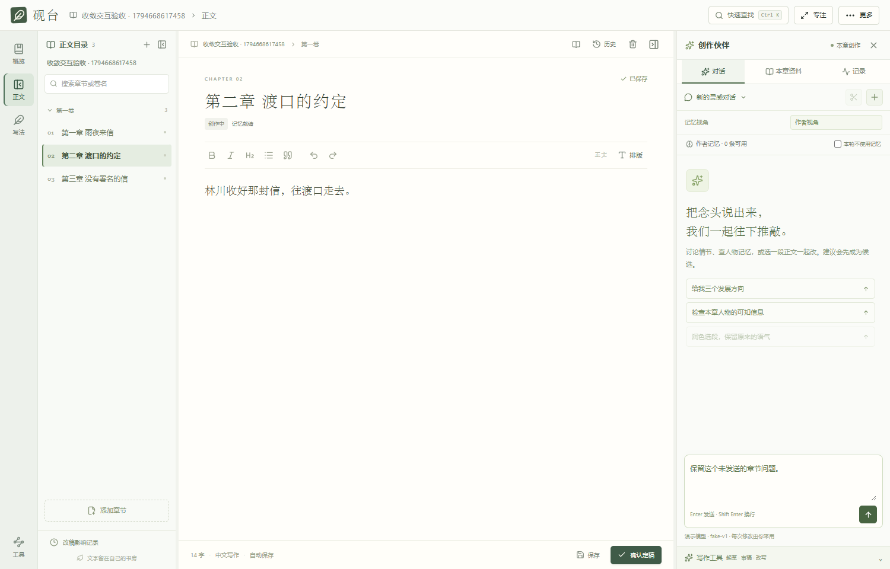

# v0.5.0 · 作者记忆与连续写作

日期：2026-11-15

打开一本书，先看到写作进度、需要处理的事和下一步。v0.5.0 把日常创作收在更简洁的界面里，并让作者偏好、自己的文字样例和反复改稿连起来。

## 下载

- [Windows x64 便携包：Yantai-v0.5.0-windows-x64.zip](https://github.com/ToStarLiu/yantai-novel/releases/download/v0.5.0/Yantai-v0.5.0-windows-x64.zip)
- [SHA-256 校验：SHA256SUMS.txt](https://github.com/ToStarLiu/yantai-novel/releases/download/v0.5.0/SHA256SUMS.txt)
- [版本与构建清单：release.json](https://github.com/ToStarLiu/yantai-novel/releases/download/v0.5.0/release.json)
- [源码与完整 README](https://github.com/ToStarLiu/yantai-novel/tree/v0.5.0)

完整解压后运行 `Yantai.exe`，保留同目录的其他文件。便携包包含本机 API、PostgreSQL、Web、Node/Pi 与中文字体，首次运行创建独立数据目录与随机本机账户并自动登录。

可在 PowerShell 中校验下载文件，将结果与 `SHA256SUMS.txt` 对照：

```powershell
Get-FileHash -Algorithm SHA256 .\Yantai-v0.5.0-windows-x64.zip
```

## 这次更好用的地方

### 进入一本书，就知道从哪里继续

作品首页只保留“作品概览、设定与规划、卷章目录”。概览按真实正文和版本显示进度；“继续写作”恢复当前浏览器中这本书上次打开的有效章节，记忆提醒则直达后台队列里需要核对的章。空白初始版本不会误算为已写正文。

写作时，正文、章节目录和创作伙伴保持在一起。助手常驻入口收为“对话、本章资料、记录”；画布、配置、作者记忆与导入导出等操作按需从工具或“更多”打开。



### 让合作记得住作者的取舍

新增账号私有作者记忆，可以保存跨书偏好、本书文风、合作习惯与对话要点。作者可手动添加、从自己的消息整理记忆，或确认助手提出的建议；每次任务可以关闭偏好，查看实际使用的条目与版本，也可随时修改、停用或忘记。

适用的对话、起草、改写、章纲、批量与多候选任务参考这些偏好；一致性审稿和事实提取排除个人偏好。记忆是可纠正的上下文参考，不是在线训练。

### 在一处说清楚“这本书应该怎么写”

“设定与规划 → 文风与写法”集中展示本书的文风、节奏、限制、自己的文字样例和写作 Skills。既有指南导入、来源与许可预览、任务用途和版本管理继续保留。编辑冲突时保留草稿，不用旧要求覆盖新版本。

### 在原来的候选上继续打磨

候选可以明确引用上一稿继续修改，也可以只打磨候选中的一段，保留其他段落。先查看与上一稿的变化，再以当前保存原稿为基准选择采用；普通选段改写也能带回对话继续打磨。原稿和父候选保留，采用失败时仍显示尚未采用。

全书讨论按需展开，同页切换或收起后保留未发送内容。离开作品或创建章节前先检查未保存的规划、设定和文风草稿；取消离开不会先创建一个多余章节。

## 从旧版升级

**本版本包含数据库迁移：v0.4.0 的 schema21 升到 schema23。升级前先备份，旧程序不能直接作为无损回退。**

### Windows 便携版

1. 暂停编辑与生成，等待正在运行的任务结束；结果未知的调用先保留待核对状态。
2. 在旧版菜单“砚台 → 打开数据与模型配置目录”定位数据目录，然后完全退出旧版。备份整个数据目录，保留其中的数据库、配置、登录信息与 `provider-master.key`。如使用数据库转储，也要保留匹配的主密钥。
3. 把 v0.5.0 解压到**新的程序目录**。保留原来的独立作者数据目录，不把新包资源或空数据覆盖进去。
4. 启动新版；启动器会先运行迁移。确认作品、正文版本、设定、记忆和模型配置，再恢复编辑。

回退时保留升级后新稿，按升级前备份恢复到隔离副本，再使用匹配的旧版本核对。不要运行 `migrate-down` 来回退有价值的数据。

### Web / 自托管源码实例

暂停写入，完成数据库与对应供应商主密钥的备份和恢复演练后，再显式迁移；API 与独立 Worker 使用同一版本。操作见[升级指南](https://github.com/ToStarLiu/yantai-novel/blob/v0.5.0/deploy/upgrade.md)和[备份恢复](https://github.com/ToStarLiu/yantai-novel/blob/v0.5.0/deploy/backup-restore.md)。

### From an earlier version

Back up the database and matching provider master key before upgrading from v0.4.0. Fully close the old desktop application, extract v0.5.0 into a new program directory, preserve its separate author data directory, and launch the new application. It applies schema21 → schema23 migrations before starting the API. Reverting requires a verified pre-upgrade backup; do not overwrite author data or use `migrate-down` as a rollback.

## 使用与数据边界

- 在“更多 → AI 供应商”连接自己的模型。未配置时的演示模型用于探索流程，不能据此判断写作质量。真实模型、检索、封面和语音服务按各自配置与计费规则运行。
- 最近章节、排版和面板偏好保存在当前浏览器，不自动跨设备同步。已发送对话持久保存；同页切换保留未发送草稿，离开整本书、刷新或关闭程序不保证保留未发送消息。
- 作者记忆和私人任务输入按账号隔离，单作品包不带这些私人资料。生成候选与采用后的正文仍按作品权限共享；外部模型会收到任务允许使用的输入。
- 完整实例备份包含私人记忆、对话与任务快照，应按私密资料保存。“忘记”不删除所有历史聊天、稿件或已有备份。
- 没有 CRDT/OT 字符级实时合并；Docker Compose 仍需独立部署验证。文学效果、长期文风和节约修改时间需要真实作品评价。

## 验证与说明

作者工作流收敛已记录完整 **47 项 Chrome 用例**、**16 项前端单测**，并有空白正文汇总的数据库专项、类型检查、生产构建与主实例只读检查。GitHub CI 已执行252项Go测试，Pi源码与独立bundle各29项通过。Windows桌面实际验证了独立服务启动、作者记忆、Skill读取、连续改稿与Diff采用，重启后数据保留；旧版验收数据的schema21→23迁移也已核对。此前作者记忆和连续改稿另有非空备份恢复记录。每轮检查及发行包验证的实际范围见[验收日志](https://github.com/ToStarLiu/yantai-novel/blob/v0.5.0/docs/release/acceptance.md)。这些结果不代替模型文学效果评价。

[使用流程](https://github.com/ToStarLiu/yantai-novel/blob/v0.5.0/docs/development/author-workflow.md) · [已知限制](https://github.com/ToStarLiu/yantai-novel/blob/v0.5.0/docs/release/known-limitations.md) · [更新记录](https://github.com/ToStarLiu/yantai-novel/blob/v0.5.0/CHANGELOG.md)

本项目原创代码采用 **GPL-3.0-only**；依赖、字体和导入的第三方写作指南保留各自许可，见[许可证清单](https://github.com/ToStarLiu/yantai-novel/blob/v0.5.0/docs/licenses.md)。
